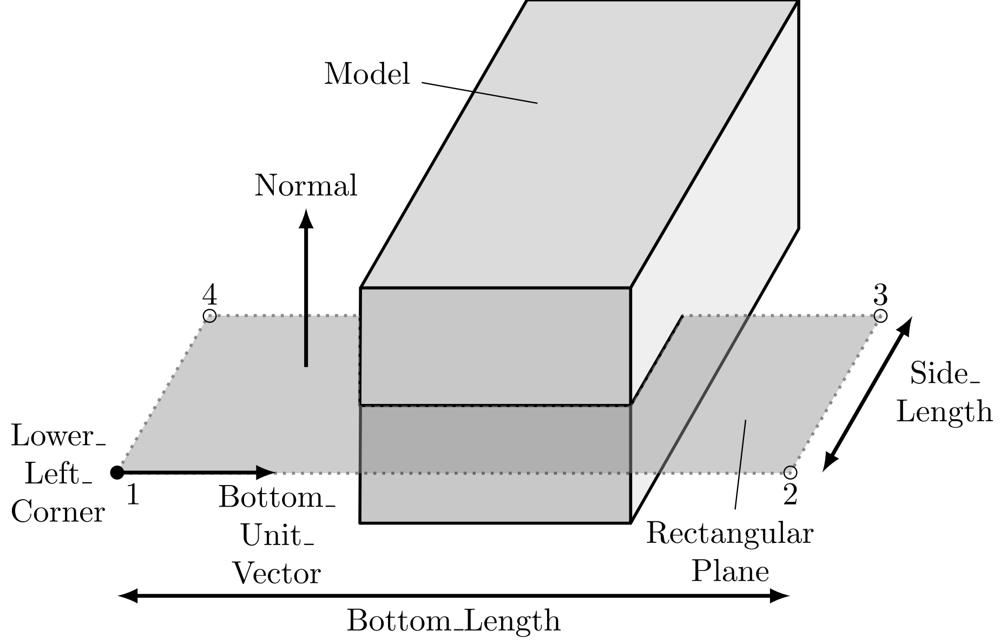

# Bond-Filters

## Rectangular Plane

A rectangle in a plane given by its normal; bonds crossing it are cut.



The yaml definition looks like this

```yaml
Bond Filters:
  bf_1:
    Bottom Length: 2.0
    Bottom Unit Vector X: 1.0
    Bottom Unit Vector Y: 0.0
    Bottom Unit Vector Z: 0.0
    Lower Left Corner X: -0.5
    Lower Left Corner Y: 0.0
    Lower Left Corner Z: -1.0
    Normal X: 0.0
    Normal Y: 1.0
    Normal Z: 0.0
    Side Length: 2.0
    Type: Rectangular_Plane
```

## Disk

A disk given by its center, normal and radius; bonds crossing it are cut.

## Keys

Both filters are entries of `Bond Filters` in the `Discretization` section:

```@eval
using PeriLab, Markdown
Markdown.parse(PeriLab.parameter_table("Discretization → Bond Filters"))
```
