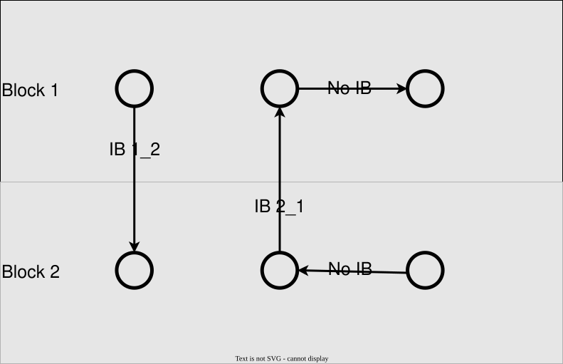

# Damage Models

Every damage model entry accepts these shared keys:

```@eval
using PeriLab, Markdown
Markdown.parse(PeriLab.parameter_table("Damage Models"))
```

## Damage index
The damage index $\phi$ of a material point is computed as [BobaruF2016](@cite)
$$\phi = \frac{\int_{\mathcal{H}}(1-\chi\langle\boldsymbol{\xi}\rangle)dV_{\xi}}{\int_{\mathcal{H}}dV_{\xi}}=\frac{\sum^n_{i=1}(1-\chi_i) dV_i}{\sum^n_{i=1} dV_i}$$
with $\chi$ is the bond damage between 0 (broken) and 1 (unbroken), $V$ is the volume and $n$ is the number of neighbors.

## Critical Stretch
The critical value corresponds to the critical stretch for this model, defined in the [theory manual](../../theory/theory_damage.md#Critical-stretch).

```@eval
using PeriLab, Markdown
Markdown.parse(PeriLab.parameter_table("Critical Stretch"))
```

## Critical Energy
The critical value is the critical energy release rate; a bond breaks once its energy exceeds the critical bond energy derived from it, see the [theory manual](../../theory/theory_damage.md#Critical-energy).

```@eval
using PeriLab, Markdown
Markdown.parse(PeriLab.parameter_table("Critical Energy"))
```

## Critical Energy Anisotropic
Like Critical Energy, but with different critical values along the material axes, given in the `Anisotropic Damage` section. The material axes follow the node orientations (`Angles` in the mesh file).

```@eval
using PeriLab, Markdown
Markdown.parse(PeriLab.parameter_table("Critical Energy Anisotropic"))
```

`Anisotropic Damage`:

```@eval
using PeriLab, Markdown
Markdown.parse(PeriLab.parameter_table("Damage Models → Anisotropic Damage"))
```

## Interblock Damage

Interlaminar behaviour between different material blocks can be defined using the `Interblock Critical Value` parameter.
If a Bond is crossing a block interface, a user defined critical damage value is applied to the bonds.

As bonds are bidirectional, the critical damage value can be defined for both orientations, for example:

- **Interblock Damage**:
    - Interblock Critical Value 1_2: 0.1
    - Interblock Critical Value 2_1: 0.1

Bonds that aren't crossing a block interface are not affected by the interblock damage model.




## Local Damping

Silling proposed a local damping to reduce waves induced by cracked bonds in [BobaruF2016](@cite) in (EQ 2.34). This proposed algorithm is introduced in [Material_Basis.jl](https://github.com/PeriHub/PeriLab.jl/blob/main/src/Models/Material/Material_Basis.jl).

The bond force due to damping is computed as

$$\mathbf{t}_{damp}\langle\boldsymbol{\xi}\rangle = \overline{\phi}d c\frac{|\eta_{i}|-|\eta_{i-1}|}{dt v_0}\frac{\eta_i}{|\eta_i|}$$
with the numerical local damping coefficient $d$, the bond stiffness $c$, the rate of bond extension
$$\dot{e}=\frac{|\eta_{i}|-|\eta_{i-1}|}{dt},$$
where $|\eta_{i}|$ and $|\eta_{i-1}|$ the length of the deformed bond vector at iteration step $i$ and $i-1$ and $dt$ is the time increment.

The average damage index between point $i$ and it's neighbor $j$ can be computed as
$$\overline{\phi}=\frac{\phi_i+\phi_j}{2}$$
and using the Young's modulus $E$ and the mass density $\rho$ the dilatation wave speed [PartmannK2024](@cite) as

$$v_0=\sqrt{\frac{E}{\rho}}$$

It is switched on with a `Local Damping` section in the damage model entry:

```@eval
using PeriLab, Markdown
Markdown.parse(PeriLab.parameter_table("Damage Models → Local Damping"))
```
