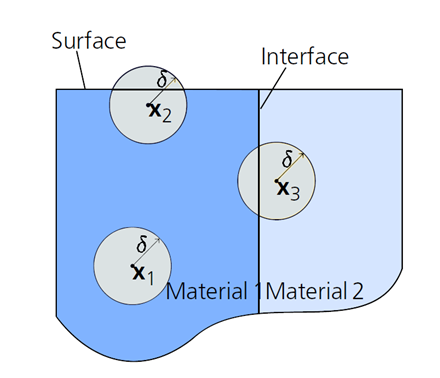
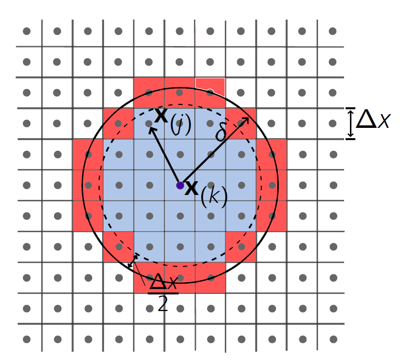

# Surface correction
There are several ways to deal with the surface correction in Peridynamics. The issue is caused, because parts of the intergral domain $\mathcal{H}$ near a surface lies outside of the material or is mixed between materials (shown in the figure). This leads to errors in the computation of the force densities. For smaller horizons, obviously this effect can be reduced. However, there are several methods to mitigate the issue described in this study [LeQV2018](@cite).

## Volume correction
Following the study of Le and Bobaru

!!! info "Quote [LeQV2018](@cite)"
    the simplest correction methods to implement, the volume correction method, also appear to be one of the most effective. Correction methods reduce the PD surface effect faster (more efficiently) than simply using a smaller horizon (problem shown in the figure).

a volume corrections factor $\lambda_{corr}$ is introduced deviding the domain volume $V_0$ by the avarage of the domain volumes of point  $\mathbf{x}$ and $\mathbf{x}'$.

$$\lambda_{corr}=\frac{2V_0}{V(\mathbf{x})+V(\mathbf{x}')}$$

The reference volume $V_0$ is the domain volume of a node with a full horizon. The analytical horizon volume is

$$V_{0-3D}=\frac{4\pi\delta^3}{3}, \qquad V_{0-2D}=\pi\delta^2$$

(in 2D the mesh volumes are areas). The discrete neighbor sum of an interior node differs from it by several percent (the node itself is excluded, partial volumes at the horizon edge are not treated). PeriLab therefore takes the domain volume of the most embedded node of the block, $V_0 = V_{0,analytical}\max_k V(\mathbf{x}_k)/V_{0,analytical}(\mathbf{x}_k)$, so bonds between interior nodes get $\lambda_{corr}=1$ and only bonds near surfaces are scaled up. A block thinner than two horizons has no fully embedded node; its most embedded node is then taken as the reference.

this factor is than multiplied to the bond force
$$\mathbf{t}_{corr} =\lambda_{corr}\mathbf{t}$$

!!! warn "Only mechanical"
    Surface correction is right now only applied for mechanical properties.

!!! info "Bond-based and ordinary state-based models"
    The volume correction scales the bond forces. It is meant for bond-based and ordinary state-based models. Correspondence models (also bond-associated) are skipped with an info message: their shape tensor already accounts for missing neighbors, a second correction would stiffen the surfaces.

!!! info "Pre-cracks"
    Bonds cut by a bond filter count as missing, so the faces of a pre-crack are corrected like free surfaces.

!!! note "Directional error"
    The factor is isotropic, the missing bonds are not. For a surface parallel to the load, the missing bonds point mostly across the load, so the correction overshoots there: in a 2D bond-based bar under tension the surface nodes go from about 20 % too soft to about 25 % too stiff. The mean error of the bar still decreases.

You can apply the surface correction initialy for all outer surfaces and continuous, for cracks or additive manufacturing.
